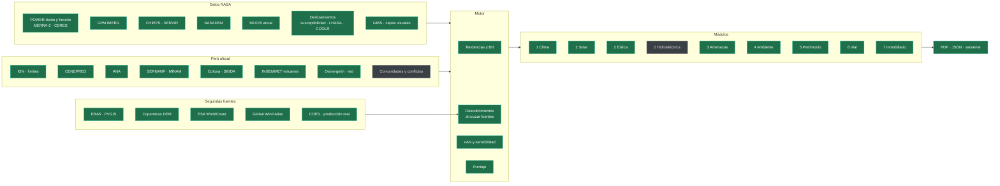

# Pipeline del proyecto: lo hecho, lo que falta y lo que se puede agregar

Estado al **10-nov-2026** (`master` = `dd09f34`). Entrega final: **15-nov, 23:59**. Cómo empezar a trabajar: [EMPEZAR_AQUI.md](EMPEZAR_AQUI.md).

## El recorrido de un análisis

Cada consulta pasa por las mismas nueve etapas en todos los módulos. La consola las muestra en vivo y el PDF las resume.

```mermaid
flowchart LR
  A[1 · Selección<br/>sitio, territorio IGN<br/>o geometría propia] --> B[2 · Configuración<br/>período y supuestos]
  B --> C[3 · Extracción<br/>fuentes con caché<br/>y procedencia]
  C --> D[4 · Análisis<br/>Mann–Kendall, Sen, BH]
  D --> E[5 · Territorio<br/>relieve y capas oficiales]
  E --> F[6 · Evaluación<br/>puntaje multicriterio]
  F --> G[7 · Finanzas<br/>VAN, escenarios, tornado]
  G --> H[8 · Resultados<br/>preguntas NASA,<br/>descubrimientos, brechas]
  H --> I[9 · Exportación<br/>PDF y JSON]
```

## Mapa de lo construido

Verde = funcionando y verificado · ámbar = en curso o parcial · gris = pendiente.

Detalle de cada fuente, versión, licencia y limitación: [`DATA_SOURCES.md`](../nasa-submission/DATA_SOURCES.md). Las cifras de validación están en los ADR de [`DECISION_LOG.md`](../architecture/DECISION_LOG.md). Por ejemplo, en ADR-041 la eólica se compara con la producción real 2024 de Marcona.

## Lo que falta para el 15-nov

Por prioridad. Cada tarea lleva su perfil, sus archivos de partida y cuándo cuenta como terminada.

| # | Tarea | Perfil | Tamaño | Empezar por | Está terminada cuando |
|---|---|---|---|---|---|
| F1 | **Hidroeléctrica**, la promesa del anteproyecto. Caudal diario GloFAS (vía Open-Meteo, 1984–hoy, 0.05°) y salto entre toma y casa de máquinas con NASADEM y Copernicus, para calcular potencia, energía y VAN. | Backend Python, datos | Grande (2–3 días) | `sectors/wind.py` como modelo; ADR-041 | Funciona en la consola con un caso real, tiene pruebas sin red, se contrasta con una segunda fuente (lluvia IMERG/CHIRPS frente a caudal, o producción COES de una central hidro) y tiene su ADR. |
| F2 | **Escenarios de la demo** con casos reales: Marcona (eólica), Moquegua (clima y el «día de 300 mm» que solo ve un modelo), Chosica (deslizamientos) y el corredor Moquegua–Ilo. | Producto, cualquiera | Mediano | `docs/nasa-submission/DEMO_SCENARIOS.md` | Cada escenario dice qué clic dar, qué muestra la pantalla y qué frase decir; está probado de punta a punta. |
| F3 | **Video de la demo** siguiendo F2. | Comunicación | Mediano | F2 | El video está grabado con la app real, sin datos de mentira, y cumple la duración que pidan las bases. |
| F4 | **Presentación y textos de entrega** actualizados: eólica incluida, tono comercial. | Comunicación, negocio | Mediano | `docs/nasa-submission/PITCH.md` y `PROJECT_OVERVIEW.md` | Las cifras citadas coinciden con un ADR o con la app. |
| F5 | **QA de usuario**: recorrer los siete módulos como alguien de afuera, en escritorio y celular. | Cualquiera | Chico (medio día) | La app en 3100 | Cada problema queda como *issue* en GitHub con captura y pasos para reproducirlo. |
| F6 | **Puerta final y etiqueta `v0.1.0`**. | Christian con Codex | Chico | `docs/coordination/RELEASE_2026-11-15.md` | La puerta pasa sobre el commit final y la etiqueta está publicada. |

## Lo que se puede agregar

Son sugerencias. Lo que sea grande conviene dejarlo para después de la entrega.

| # | Idea | Por qué suma | Perfil | Empezar por |
|---|---|---|---|---|
| A1 | **Factor de planta real por central eólica** con el COES (hoy solo se mide la solar). | Tercera fuente para la eólica, con datos de operación reales. | Backend, datos | `connectors/energy/coes.py`; script `.claude-qa/coes_wind_check.py` en la laptop de Christian |
| A2 | **Distancia a la red eléctrica**: línea y subestación más cercanas (Osinergmin ya responde). | Hoy solo se cruza la capa; la distancia mueve el CAPEX de conexión. | Backend geoespacial | `connectors/peru/`; skill `geospatial-engineering` |
| A3 | **Pérdidas por temperatura en la solar**: hoy la T2M se mide pero no entra en la energía. | Energía más realista en la costa caliente. | Backend, energía | `sectors/solar.py` (`calculate_solar_projection`) |
| A4 | **Comunidades y conflictos**: buscar una fuente consultable (BDPI, Defensoría, SENACE). | Es la brecha social más visible del módulo 5. | Investigación de fuentes | Nodo `in-social` en `docs/interno/dop-datos.js` |
| A5 | **Emergencias viales reales** (INDECI, MTC) para validar la exposición del corredor. | Validación del piloto vial con eventos ocurridos. | Datos | `sectors/road.py` |
| A6 | **Avifauna y rutas migratorias** para la eólica. | Hoy figura como brecha; los parques eólicos la necesitan. | Ambiente, datos | Brechas de `sectors/wind.py` |
| A7 | **Interfaz en inglés** para el jurado global. | Alcance internacional. | Frontend | `frontend/app/_components/` |
| A8 | **Mantenimiento de dependencias** (pypdf, starlette, pytest) en una rama aparte. | Codex encontró avisos de seguridad previos. | Backend | `backend/requirements.txt` |

Para después del hackathon quedan la persistencia con PostGIS, la API pública con límites de uso, el monitoreo recurrente de activos y el calibrador neuronal solar.

## Preguntas abiertas para el equipo

- ¿Quién toma cada tarea F1–F5? Propuesta: anotarse en el grupo y abrir la rama con su nombre.
- ¿Qué exige exactamente la entrega final de la sede: duración del video, láminas, enlace al repositorio público o privado? Revisarlo en las bases antes del jueves 13.
- ¿El repositorio se hace público para la entrega? Antes de abrirlo hay que revisar la licencia de cada fuente (`DATA_SOURCES.md`) y que no quede ningún secreto en el historial.
