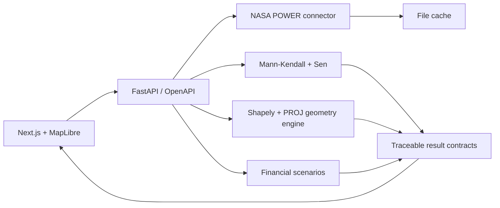

# Technical Architecture

The frontend selects location, variable, and period. The API validates inputs with Pydantic, obtains or reuses NASA data, and emits reproducible contracts. Geometry inspection validates and measures WGS84 features without making unsupported risk claims. The financial engine only accepts explicit user assumptions. Docker Compose runs both layers as an isolated project on ports 3100 and 8000.

Current endpoints:

- `GET /api/v1/health`
- `GET /api/v1/sources`
- `POST /api/v1/analyses/point`
- `POST /api/v1/comparisons/sites`
- `POST /api/v1/geospatial/inspect`
- `POST /api/v1/finance/npv`

PostGIS and a job queue remain planned for persistent geometries, corridor sampling, and raster workloads.
