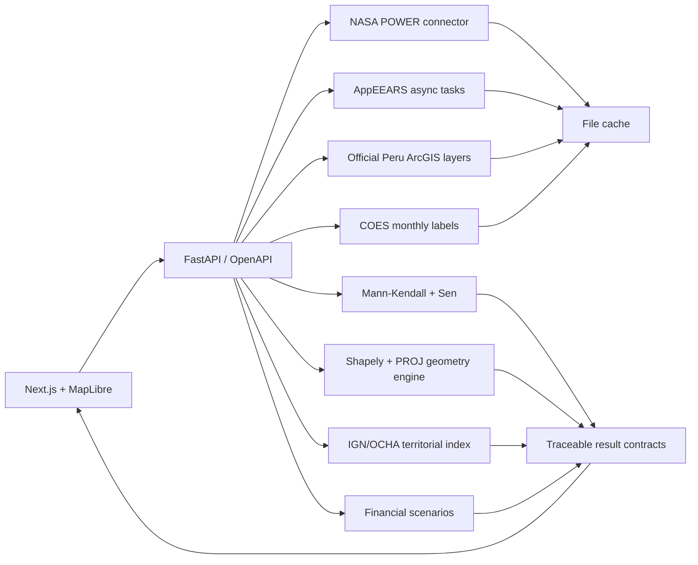

# Technical Architecture

The frontend selects location, variable, and period. The API validates inputs with Pydantic, obtains or reuses NASA data, and emits reproducible contracts. Geometry inspection validates and measures WGS84 features without making unsupported risk claims. The financial engine only accepts explicit user assumptions. Docker Compose runs both layers as an isolated project on ports 3100 and 8000.

Current endpoints:

- `GET /api/v1/health`
- `GET /api/v1/sources`
- `POST /api/v1/analyses/point`
- `POST /api/v1/comparisons/sites`
- `POST /api/v1/geospatial/inspect`
- `POST /api/v1/finance/npv`
- `GET /api/v1/territories/search`
- `GET /api/v1/territories/hierarchy`
- `GET /api/v1/territories/{level}/{ubigeo}/geometry`
- `POST /api/v1/spatial-sampling/power/daily`

- `POST /api/v1/earthdata/appeears/tasks/point`
- `POST /api/v1/earthdata/appeears/tasks/area`
- `GET /api/v1/earthdata/appeears/tasks/{task_id}`
- `GET /api/v1/earthdata/appeears/tasks/{task_id}/bundle`
- `GET /api/v1/earthdata/appeears/tasks/{task_id}/bundle/{file_id}`
- `POST /api/v1/territory/query`
- `POST /api/v1/energy/coes/monthly-generation`

Connector payloads use a content-addressed raw cache: the SHA-256 named provider response is immutable and a small request manifest points to it. AppEEARS credentials and tokens are excluded from both layers. AppEEARS logs in for each operation, renews on HTTP 403, and logs out in `finally`; tasks remain asynchronous at the NASA service. Bundle downloads verify the provider SHA-256 before caching, follow only an explicit HTTPS host allowlist, and never forward the Earthdata token to the object-storage redirect. COES exports are fetched sequentially one closed month at a time with `indicador=1`; the XLSX container, sheet and headers are validated before daily MWh values are aggregated by exact central name. GISEM capacity and coordinates enrich the result only after an exact name match; a failed cross-source lookup never hides the COES generation.

PostGIS and a local job queue remain planned for persistent geometries, bulk corridor sampling, and locally managed raster workloads. AppEEARS does not depend on that queue because NASA owns the asynchronous task lifecycle.

K5 is served from versioned, read-only GeoJSON assets under `backend/data/territory`. `scripts/data/build_peru_territory.py` pins the official HDX ZIP by SHA-256, validates the 25/196/1,873 hierarchy in CRS84, simplifies in metres with an adaptive ≤1% geodesic-area-change gate, and writes per-asset hashes. The API verifies those hashes before loading. Search and hierarchy use a geometry-free index; only the requested level GeoJSON is loaded lazily. This keeps 2015 boundaries visibly qualified and prevents a corrupted asset from silently entering the selector.

K1 validates GeoJSON in WGS84, buffers corridors in a local azimuthal-equidistant projection, and switches only sub-cell polygons to the POWER point endpoint. Larger subjects use one variable per POWER regional request. Returned cell centers define the observed grid spacing; inferred cell footprints are intersected with the subject and weighted by geodesic overlap area. The API returns both the area-weighted aggregate/dispersion and every underlying cell series. Provider JSON uses the immutable content-addressed cache, and duplicate centers with conflicting values stop the request.

