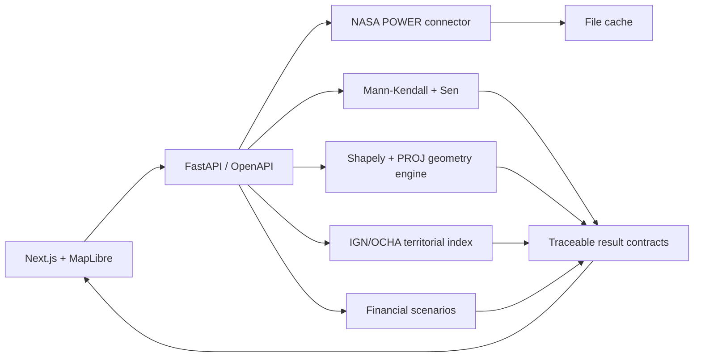

# Technical Architecture

The frontend selects location, variable, and period. The API validates inputs with Pydantic, obtains or reuses NASA data, and emits reproducible contracts. Geometry inspection validates and measures WGS84 features without making unsupported risk claims. The financial engine only accepts explicit user assumptions. Docker Compose runs both layers as an isolated project on ports 3100 and 8000.

Current endpoints:

- `GET /api/v1/health`
- `GET /api/v1/sources`
- `POST /api/v1/analyses/point`
- `POST /api/v1/comparisons/sites`
- `POST /api/v1/geospatial/inspect`
- `POST /api/v1/finance/npv`
- `GET /api/v1/territories/search`
- `GET /api/v1/territories/hierarchy`
- `GET /api/v1/territories/{level}/{ubigeo}/geometry`
- `POST /api/v1/spatial-sampling/power/daily`

K5 is served from versioned, read-only GeoJSON assets under `backend/data/territory`. `scripts/data/build_peru_territory.py` pins the official HDX ZIP by SHA-256, validates the 25/196/1,873 hierarchy in CRS84, simplifies in metres with an adaptive ≤1% geodesic-area-change gate, and writes per-asset hashes. The API verifies those hashes before loading. Search and hierarchy use a geometry-free index; only the requested level GeoJSON is loaded lazily. This keeps 2015 boundaries visibly qualified and prevents a corrupted asset from silently entering the selector.

K1 validates GeoJSON in WGS84, buffers corridors in a local azimuthal-equidistant projection, and switches only sub-cell polygons to the POWER point endpoint. Larger subjects use one variable per POWER regional request. Returned cell centers define the observed grid spacing; inferred cell footprints are intersected with the subject and weighted by geodesic overlap area. The API returns both the area-weighted aggregate/dispersion and every underlying cell series. Provider JSON uses the immutable content-addressed cache, and duplicate centers with conflicting values stop the request.

PostGIS and a job queue remain planned for persistent geometries, bulk multi-variable runs, and raster workloads.
