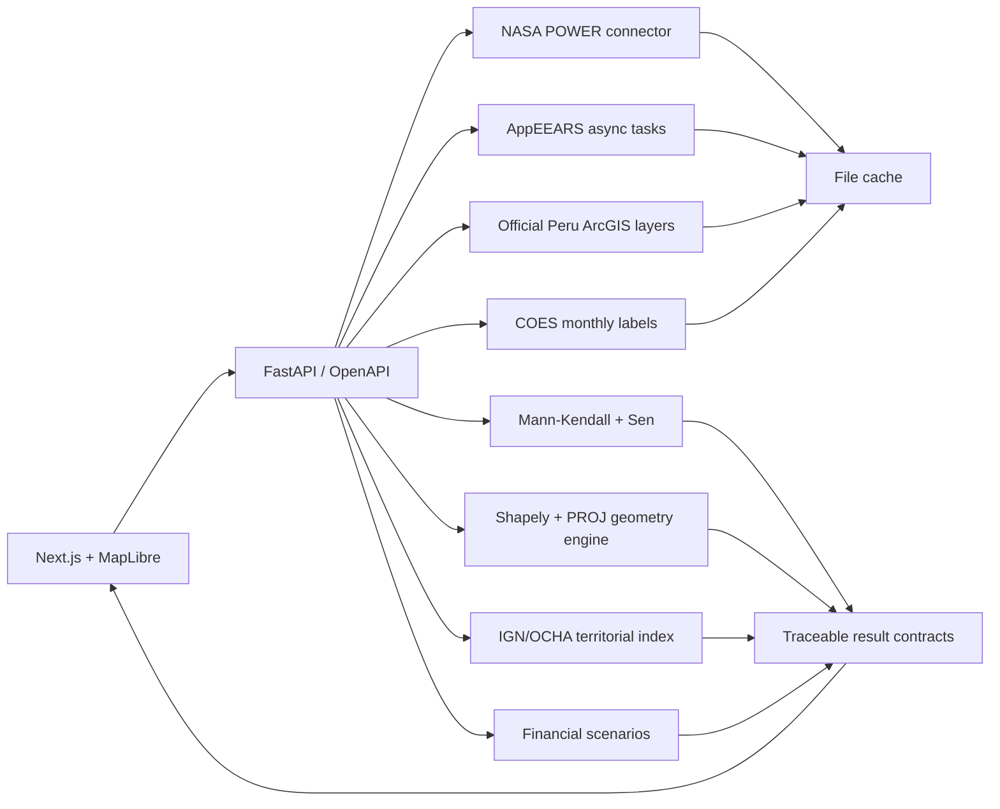

# Technical Architecture

The frontend selects location, variable, and period. The API validates inputs with Pydantic, obtains or reuses NASA data, and emits reproducible contracts. Geometry inspection validates and measures WGS84 features without making unsupported risk claims. The financial engine only accepts explicit user assumptions. Docker Compose runs both layers as an isolated project on ports 3100 and 8000.

Current endpoints:

- `GET /api/v1/health`
- `GET /api/v1/sources`
- `GET /api/v1/map/layers`
- `POST /api/v1/analyses/point`
- `POST /api/v1/comparisons/sites`
- `POST /api/v1/terrain/points`
- `POST /api/v1/projects/solar-screening`
- `POST /api/v1/projects/climate-screening`
- `POST /api/v1/projects/road-screening`
- `POST /api/v1/projects/real-estate-screening`
- `POST /api/v1/geospatial/inspect`
- `POST /api/v1/finance/npv`
- `POST /api/v1/scoring/scorecard`
- `GET /api/v1/assistant/status`
- `POST /api/v1/assistant/ask`
- `POST /api/v1/reports/executive-pdf`
- `GET /api/v1/territories/search`
- `GET /api/v1/territories/hierarchy`
- `GET /api/v1/territories/{level}/{ubigeo}/geometry`
- `POST /api/v1/spatial-sampling/power/daily`
- `POST /api/v1/earthdata/appeears/tasks/point`
- `POST /api/v1/earthdata/appeears/tasks/area`
- `GET /api/v1/earthdata/appeears/tasks/{task_id}`
- `GET /api/v1/earthdata/appeears/tasks/{task_id}/bundle`
- `GET /api/v1/earthdata/appeears/tasks/{task_id}/bundle/{file_id}`
- `POST /api/v1/territory/query`
- `POST /api/v1/energy/coes/monthly-generation`

Connector payloads use a content-addressed raw cache: the SHA-256 named provider response is immutable and a small request manifest points to it. AppEEARS credentials and tokens are excluded from both layers. AppEEARS logs in for each operation, renews on HTTP 403, and logs out in `finally`; tasks remain asynchronous at the NASA service. Bundle downloads verify the provider SHA-256 before caching, follow only an explicit HTTPS host allowlist, and never forward the Earthdata token to the object-storage redirect. COES exports are fetched sequentially one closed month at a time with `indicador=1`; the XLSX container, sheet and headers are validated before daily MWh values are aggregated by exact central name. GISEM capacity and coordinates enrich the result only after an exact name match; a failed cross-source lookup never hides the COES generation.

PostGIS and a local job queue remain planned for persistent geometries, bulk corridor sampling, and locally managed raster workloads. AppEEARS does not depend on that queue because NASA owns the asynchronous task lifecycle.

K5 is served from versioned, read-only GeoJSON assets under `backend/data/territory`. `scripts/data/build_peru_territory.py` pins the official HDX ZIP by SHA-256, validates the 25/196/1,873 hierarchy in CRS84, simplifies in metres with an adaptive ≤1% geodesic-area-change gate, and writes per-asset hashes. The API verifies those hashes before loading. Search and hierarchy use a geometry-free index; only the requested level GeoJSON is loaded lazily. This keeps 2015 boundaries visibly qualified and prevents a corrupted asset from silently entering the selector.

K1 validates GeoJSON in WGS84, buffers corridors in a local azimuthal-equidistant projection, and switches only sub-cell polygons to the POWER point endpoint. Larger subjects use one variable per POWER regional request. Periods longer than the provider's 366-day limit are partitioned by calendar year and cached per fragment; the merge requires stable cell centers and units and rejects conflicting dates or values. Returned cell centers define the observed grid spacing; inferred cell footprints are intersected with the subject and weighted by geodesic overlap area. The API returns both the area-weighted aggregate/dispersion and every underlying cell series. Provider JSON uses the immutable content-addressed cache, and duplicate centers with conflicting values stop the request.

K2 is the road-corridor screening service behind the integrated Infrastructure module. Its default public pilot is an ODbL-attributed OpenStreetMap route calculated with OSRM between Moquegua and Ilo and split into five contiguous WGS84 segments. In parallel, each segment obtains NASA POWER daily precipitation/temperature at a representative point, K1 area-weighted precipitation cells over a user-declared corridor buffer, NASADEM terrain when authenticated tiles are available, and intersections from the configured official Peruvian layers. The result inherits `ScreeningEnvelope` v1.0 and adds typed road results, territorial evidence, a six-criterion scorecard and a mitigation NPV with base/adverse/favorable scenarios, tornado and break-even values. The precipitation score uses the linearly interpolated 99th percentile of the recent area-weighted daily series; RX1DAY remains in the response for traceability and triggers an atypical-extreme warning when it is far above P99. This prevents the known 12–13 Sep 2022 MERRA-2 artifact from dominating the priority score while retaining it for IMERG or gauge review. Interruption days, cost per day, CAPEX, maintenance, residual interruption, discount rate and horizon are always `USER_ASSUMPTION`; NASA observations never become traffic, closure or loss observations. Missing terrain or official layers reduce score coverage and create `DATA_UNAVAILABLE` gaps rather than zero risk. The endpoint is screening, not road design, hydrology, geotechnics, environmental/social due diligence or investment feasibility.

K3 is the real-estate screening service behind the integrated Investment module. Each subject is either a user-supplied WGS84 Polygon/MultiPolygon (`USER_ASSUMPTION`) or an IGN/OCHA COD-AB territory reference resolved by level and ubigeo (`REAL_DATA`, CC BY-IGO, 2015 boundaries). All 12 MultiPolygon territories in the pinned catalog are supported, including flattened GeoJSON rings for ArcGIS intersection requests. Shapely validates topology and an ellipsoidal WGS84 calculation provides the unrounded area used by finance; a guaranteed interior point, rather than a potentially exterior centroid, anchors POWER and NASADEM. K1 supplies recent area-weighted precipitation and a robust P99, while official territorial services provide qualified intersection alerts. The score omits any criterion whose required source is unavailable and reports coverage; a zero returned intersection is never labelled zero risk. With one subject the scorecard explicitly returns `margin=null` and `tie=false` and explains that no comparison exists.

The financial model charges land and mitigation at time zero and recognizes construction, selling cost and revenue as the assumed annual absorption is sold. All commercial and planning variables are `USER_ASSUMPTION`; no NASA or territorial observation is converted into price, buildability or demand. Geometries above 2 km² (200 ha) remain valid for exposure analysis, but the response adds a caution both to the subject and to the fifth NASA question: applying the assumed developable fraction to the entire geometry does not describe a real-estate project, and a parcel polygon is required for project evaluation. This prevents a district such as Samegua from presenting its territory-wide illustrative NPV as a project NPV. The endpoint is not cadastral, legal, urban-planning, market, engineering or investment feasibility evidence.

## Cross-module release boundary

The four operational decision modules share the C2 envelope but keep their sector-specific evidence and limitations:

| Module | Endpoint | Primary decision output | Scientific guardrail |
|---|---|---|---|
| Climate | `/api/v1/projects/climate-screening` | trends, ETCCDI-style extremes and atypical years | Hamed–Rao + BH; provider anomalies remain visible and require IMERG/station countercheck |
| Renewable energy | `/api/v1/projects/solar-screening` | solar resource, conditional NPV, sensitivity and score | resource is observed/modelled; prices, costs and discount rate are user assumptions |
| Road infrastructure | `/api/v1/projects/road-screening` | segment exposure and mitigation priority | P99 enters the score; RX1DAY remains traceable; screening is not road design |
| Real estate | `/api/v1/projects/real-estate-screening` | parcel/territory exposure and conditional project economics | areas above 200 ha are analysis areas, not project NPVs; one subject is not a ranking |

The release QA runs each module through its controlled fixtures, C2 conformance and the generic PDF/report path where applicable. It also runs the complete backend suite, the production frontend build, the scientific auditor and the dependency audit. Browser QA at 1440 px and 390 px is owned by Claude and is recorded separately; Codex does not start the reserved 3100/8000 stack.
