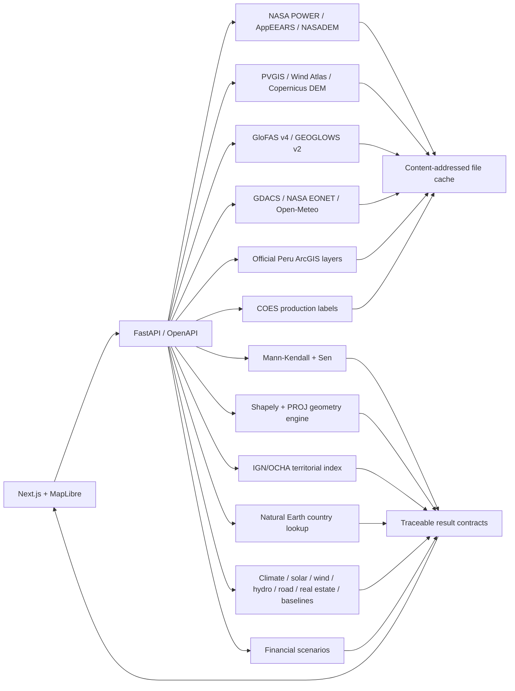

# Technical Architecture

> **Pre-release architecture baseline · updated 10-Nov-2026 for the final 15-Nov-2026 submission.** No release tag has been created. This document defines the deployable architecture and verified module boundary. Later changes require an ADR or documented defect, the common quality gate, and a handoff entry. Planned components remain explicitly planned and are not part of the verified architecture.

The frontend selects location, variable, and period. The API validates inputs with Pydantic, obtains or reuses NASA data, and emits reproducible contracts. Geometry inspection validates and measures WGS84 features without making unsupported risk claims. The financial engine only accepts explicit user assumptions. Docker Compose runs both layers as an isolated project on ports 3100 and 8000.

Current endpoints:

- `GET /api/v1/health`
- `GET /api/v1/sources`
- `GET /api/v1/map/layers`
- `GET /api/v1/world/alerts`
- `GET /api/v1/world/places?q={name}`
- `GET /api/v1/world/zones`
- `GET /api/v1/world/zones/{zone_id}`
- `POST /api/v1/analyses/point`
- `POST /api/v1/comparisons/sites`
- `POST /api/v1/terrain/points`
- `POST /api/v1/projects/solar-screening`
- `POST /api/v1/projects/wind-screening`
- `POST /api/v1/projects/hydro-screening`
- `POST /api/v1/projects/climate-screening`
- `POST /api/v1/projects/environment-screening`
- `POST /api/v1/projects/hazards-screening`
- `POST /api/v1/projects/heritage-screening`
- `POST /api/v1/projects/road-screening`
- `POST /api/v1/projects/real-estate-screening`
- `POST /api/v1/geospatial/inspect`
- `POST /api/v1/finance/npv`
- `POST /api/v1/scoring/scorecard`
- `GET /api/v1/assistant/status`
- `POST /api/v1/assistant/ask`
- `POST /api/v1/reports/executive-pdf`
- `GET /api/v1/territories/search`
- `GET /api/v1/territories/hierarchy`
- `GET /api/v1/territories/{level}/{ubigeo}/geometry`
- `POST /api/v1/spatial-sampling/power/daily`
- `POST /api/v1/earthdata/appeears/tasks/point`
- `POST /api/v1/earthdata/appeears/tasks/area`
- `GET /api/v1/earthdata/appeears/tasks/{task_id}`
- `GET /api/v1/earthdata/appeears/tasks/{task_id}/bundle`
- `GET /api/v1/earthdata/appeears/tasks/{task_id}/bundle/{file_id}`
- `POST /api/v1/territory/query`
- `POST /api/v1/energy/coes/monthly-generation`

Connector payloads use a content-addressed raw cache: the SHA-256 named provider response is immutable and a small request manifest points to it. AppEEARS credentials and tokens are excluded from both layers. AppEEARS logs in for each operation, renews on HTTP 403, and logs out in `finally`; tasks remain asynchronous at the NASA service. Bundle downloads verify the provider SHA-256 before caching, follow only an explicit HTTPS host allowlist, and never forward the Earthdata token to the object-storage redirect. COES exports are fetched sequentially one closed month at a time with `indicador=1`; the XLSX container, sheet and headers are validated before daily MWh values are aggregated by exact central name. GISEM capacity and coordinates enrich the result only after an exact name match; a failed cross-source lookup never hides the COES generation.

Closed scientific inputs are reused from cache with their original download timestamp and provenance. The common small-JSON transport follows ADR-044 as well: it first uses a fresh content-addressed response, then calls the provider, and only after a transport, HTTP or JSON failure may serve the last valid response for the exact request key with `CACHED_DATA`, its original timestamp and the current failure reason. A combined response is conservatively `CACHED_DATA` if any constituent request came from cache; mixed freshness is never promoted to `REAL_DATA`.

For official territorial layers, a provider failure normally remains `DATA_UNAVAILABLE`. ADR-044 adds one narrow exception: the same request-cache key may use its last successful response for up to 90 days, labelled `CACHED_DATA` with the original date and current failure reason. `stale_note` propagates through the territorial contract, environmental baseline, road and real-estate summaries, gaps, UI and PDF. This is currently material for CENEPRED, whose public ArcGIS service began returning `499 Token Required` on 10-Nov-2026. A machine without a matching pre-closure cache correctly shows “No disponible”; caches are never fabricated or copied implicitly between stacks.

## Global scope and world alerts (ADR-046)

The global shell separates navigation context from analytical evidence. Open-Meteo geocoding converts a place name into candidate WGS84 points; the selected point is only an input location and does not become evidence. Natural Earth Admin 0 polygons at 1:110m resolve a coarse country code for selecting a Global Wind Atlas country file and for deciding whether Peruvian official layers are applicable. The lookup declares a 0.5° coastal/border tolerance and returns no country over open ocean rather than guessing; it is not a legal-boundary service.

`GET /api/v1/world/alerts` orchestrates two independent providers. GDACS supplies its own red/orange/green levels and NASA EONET supplies an unlevelled second witness. The contract matches only events of an equivalent type within a declared time and geodesic-distance window, retains the source URL and never derives an alert level from NASA. If either provider fails, the other remains available and the failed source is emitted as `DATA_UNAVAILABLE`; one-hour caches and the exact-key last-valid-copy rule preserve freshness and failure evidence. The response disclaimer states that the list is informational, not an early-warning system or a substitute for national or local authorities.

Global inputs do not imply global parity. NASA, ERA5, Copernicus, GDACS and EONET-based analyses can operate outside Peru, but IGN territories and the connected CENEPRED, ANA, SERNANP, Cultura, MINAM, INGEMMET, Osinergmin and related layers are Peruvian. When a subject is outside Peru, those connectors are skipped and the response states the geographic limitation; no absent query is converted into zero exposure.

## Enter the zone: prebuilt block models (ADR-047)

“Entrar a la zona” is an exploratory block model, not a photorealistic view, hazard simulation or engineering design tool. `GET /api/v1/world/zones` lists the versioned models and `GET /api/v1/world/zones/{zone_id}` returns one complete model. The two current zones—Moquegua and Taal—are built ahead of time by the controlled zone builder and stored under `backend/data/zones/`; an interactive request never downloads rasters or constructs a new zone. Adding a place requires rebuilding, validating and versioning a new asset.

The route `/zona/{id}` dynamically loads the zone explorer with server-side rendering disabled. The `three.js` scene and its code are therefore fetched only when a person enters a zone; the ordinary map, modules and world-alert flow do not pay that runtime cost. The scene renders precomputed block heights, original real-world elevations, Horn slope calculated before declared vertical exaggeration, nearest-pixel WorldCover classes, paths and dated analytical beacons. The textual findings list remains the non-3D fallback.

Gameplay state is deliberately separate from scientific source state. The immutable `heights`, `cover` and `slope` arrays continue to drive the readout and any cell assessment. Digging, placed pieces, removed decorations and touched cells live only in transient browser-side arrays/maps; rebuilding a changed terrain chunk never rewrites the source arrays or the versioned JSON. “Deshacer” restores the prebuilt model, leaving the route discards all edits, and no gameplay action is submitted to an analytical endpoint. A placed or removed block is therefore a user sketch, not a new observation, corrected land-cover class or simulated development outcome.

PostGIS and a local job queue remain planned for persistent geometries, bulk corridor sampling, and locally managed raster workloads. AppEEARS does not depend on that queue because NASA owns the asynchronous task lifecycle.

K5 is served from versioned, read-only GeoJSON assets under `backend/data/territory`. `scripts/data/build_peru_territory.py` pins the official HDX ZIP by SHA-256, validates the 25/196/1,873 hierarchy in CRS84, simplifies in metres with an adaptive ≤1% geodesic-area-change gate, and writes per-asset hashes. The API verifies those hashes before loading. Search and hierarchy use a geometry-free index; only the requested level GeoJSON is loaded lazily. This keeps 2015 boundaries visibly qualified and prevents a corrupted asset from silently entering the selector.

K1 validates GeoJSON in WGS84, buffers corridors in a local azimuthal-equidistant projection, and switches only sub-cell polygons to the POWER point endpoint. Larger subjects use one variable per POWER regional request. Periods longer than the provider's 366-day limit are partitioned by calendar year and cached per fragment; the merge requires stable cell centers and units and rejects conflicting dates or values. Returned cell centers define the observed grid spacing; inferred cell footprints are intersected with the subject and weighted by geodesic overlap area. The API returns both the area-weighted aggregate/dispersion and every underlying cell series. Provider JSON uses the immutable content-addressed cache, and duplicate centers with conflicting values stop the request.

The renewable-energy module has three lenses over the same C2 `ScreeningEnvelope`. Solar combines NASA POWER/CERES resource series with PVGIS-ERA5 and terrain. Wind obtains ten closed years of hourly `WS50M`/`WS10M` from NASA POWER for temporal shape, then uses Global Wind Atlas 4.0 rasters at 50 m and 100 m as an independent long-term level; shear, density and a generic power curve remain screening calculations. Run-of-river hydro obtains daily modelled discharge from GloFAS v4 through the Open-Meteo Flood API, searches GEOGLOWS v2 for a second annual-flow model estimate, and derives gross head between user-defined intake and powerhouse points. GEOGLOWS and GloFAS both use ERA5 forcing, so the comparison tests different routing models and river networks rather than an independent climate observation. Energy is calculated day by day from explicit efficiency and environmental-flow assumptions. None of these paths replaces bankable resource measurement, a turbine study, basin hydrology, water rights or environmental permitting.

Second-source checks are first-class evidence, not silent fallbacks. Temperature, solar radiation and 10 m wind use PVGIS-ERA5; rainfall extremes contrast NASA POWER/MERRA-2 with GPM IMERG and CHIRPS; land cover uses ESA WorldCover against MODIS; elevation and slope use Copernicus DEM GLO-30 against NASADEM; wind level uses Global Wind Atlas against POWER; discharge uses GEOGLOWS against GloFAS; landslide context separates NASA susceptibility, LHASA probability and COOLR reports from CENEPRED susceptibility. Each crosscheck records its source, period, scale, units, status and limitations. Missing secondary evidence lowers coverage or creates a gap but does not replace the primary value with zero. Where at least two subjects all have both terrain models, solar, wind, road and real-estate scoring also recompute the original scorecard with Copernicus slopes to disclose whether the leader changes; missing contrasts do not receive invented slopes.

`ScreeningEnvelope.method_validation` is an additive `list[str]` with an empty default, so contract version 1.0 remains backward compatible. Wind and hydro use it to publish a dated, sector-level validation of the method against real COES 2024 production. These notes are constants supported by reproducible QA scripts, displayed in the Method panel and executive PDF; they are not observations or recalculations from the user's current analysis and must not be interpreted as site-specific accuracy. A method-validation statement must name its period, compared source and scope in an ADR; an empty list means no such validation is claimed, not that validation passed implicitly.

K2 is the road-corridor screening service behind the integrated Infrastructure module. Its default public pilot is an ODbL-attributed OpenStreetMap route calculated with OSRM between Moquegua and Ilo and split into five contiguous WGS84 segments. In parallel, each segment obtains NASA POWER daily precipitation/temperature at a representative point, K1 area-weighted precipitation cells over a user-declared corridor buffer, NASADEM terrain when authenticated tiles are available, and intersections from the configured official Peruvian layers. The result inherits `ScreeningEnvelope` v1.0 and adds typed road results, territorial evidence, a six-criterion scorecard and a mitigation NPV with base/adverse/favorable scenarios, tornado and break-even values. The precipitation score uses the linearly interpolated 99th percentile of the recent area-weighted daily series; RX1DAY remains in the response for traceability and triggers an atypical-extreme warning when it is far above P99. This prevents the known 12–13 Sep 2022 MERRA-2 artifact from dominating the priority score while retaining it for IMERG or gauge review. Interruption days, cost per day, CAPEX, maintenance, residual interruption, discount rate and horizon are always `USER_ASSUMPTION`; NASA observations never become traffic, closure or loss observations. Missing terrain or official layers reduce score coverage and create `DATA_UNAVAILABLE` gaps rather than zero risk. The endpoint is screening, not road design, hydrology, geotechnics, environmental/social due diligence or investment feasibility.

K3 is the real-estate screening service behind the integrated Investment module. Each subject is either a user-supplied WGS84 Polygon/MultiPolygon (`USER_ASSUMPTION`) or an IGN/OCHA COD-AB territory reference resolved by level and ubigeo (`REAL_DATA`, CC BY-IGO, 2015 boundaries). All 12 MultiPolygon territories in the pinned catalog are supported, including flattened GeoJSON rings for ArcGIS intersection requests. Shapely validates topology and an ellipsoidal WGS84 calculation provides the unrounded area used by finance; a guaranteed interior point, rather than a potentially exterior centroid, anchors POWER and NASADEM. K1 supplies recent area-weighted precipitation and a robust P99, while official territorial services provide qualified intersection alerts. The score omits any criterion whose required source is unavailable and reports coverage; a zero returned intersection is never labelled zero risk. With one subject the scorecard explicitly returns `margin=null` and `tie=false` and explains that no comparison exists.

The financial model charges land and mitigation at time zero and recognizes construction, selling cost and revenue as the assumed annual absorption is sold. All commercial and planning variables are `USER_ASSUMPTION`; no NASA or territorial observation is converted into price, buildability or demand. Geometries above 2 km² (200 ha) remain valid for exposure analysis, but the response adds a caution both to the subject and to the fifth NASA question: applying the assumed developable fraction to the entire geometry does not describe a real-estate project, and a parcel polygon is required for project evaluation. This prevents a district such as Samegua from presenting its territory-wide illustrative NPV as a project NPV. The endpoint is not cadastral, legal, urban-planning, market, engineering or investment feasibility evidence.

## Cross-module release boundary

Nine sector responses share the C2 envelope: six comparative decision lenses plus three baseline lenses presented inside the seven visible product modules. Each keeps its sector-specific evidence and limitations:

| Module | Endpoint | Primary decision output | Scientific guardrail |
|---|---|---|---|
| Climate | `/api/v1/projects/climate-screening` | trends, ETCCDI-style extremes and atypical years | Hamed–Rao + BH; provider anomalies remain visible and require IMERG/station countercheck |
| Solar energy | `/api/v1/projects/solar-screening` | solar resource, conditional NPV, sensitivity and score | resource is observed/modelled; prices, costs and discount rate are user assumptions |
| Wind energy | `/api/v1/projects/wind-screening` | hourly-shape/atlas-level yield, conditional NPV and score | generic curve and losses are assumptions; atlas and reanalysis do not replace on-site measurement |
| Run-of-river hydro | `/api/v1/projects/hydro-screening` | flow-duration energy, head, conditional NPV and score | GloFAS/GEOGLOWS are model simulations; intake, powerhouse, efficiency and environmental flow are assumptions |
| Road infrastructure | `/api/v1/projects/road-screening` | segment exposure and mitigation priority | P99 enters the score; RX1DAY remains traceable; screening is not road design |
| Real estate | `/api/v1/projects/real-estate-screening` | parcel/territory exposure and conditional project economics | areas above 200 ha are analysis areas, not project NPVs; one subject is not a ranking |
| Environmental baseline | `/api/v1/projects/environment-screening` | physical/biological baseline evidence by subject | remote and official layers support scoping, not an EIA field inventory |
| Natural hazards baseline | `/api/v1/projects/hazards-screening` | multi-source hazard evidence and counterchecks | an unavailable or non-intersecting layer never proves absence of hazard |
| Heritage baseline | `/api/v1/projects/heritage-screening` | registered/declarative heritage evidence | public layers do not replace a CIRA, fieldwork or authority determination |

The release QA runs each module through its controlled fixtures, C2 conformance and the generic PDF/report path where applicable. It also runs the complete backend suite, the production frontend build and the dependency audit. Scientific-review evidence is recorded in the ADRs; the repository currently has no `scripts/audit_project.py`, so a local scientific-auditor run must not be claimed unless that reproducible check is restored. Browser QA at 1440 px and 390 px is owned by Claude and is recorded separately; Codex does not start the reserved 3100/8000 stack.
