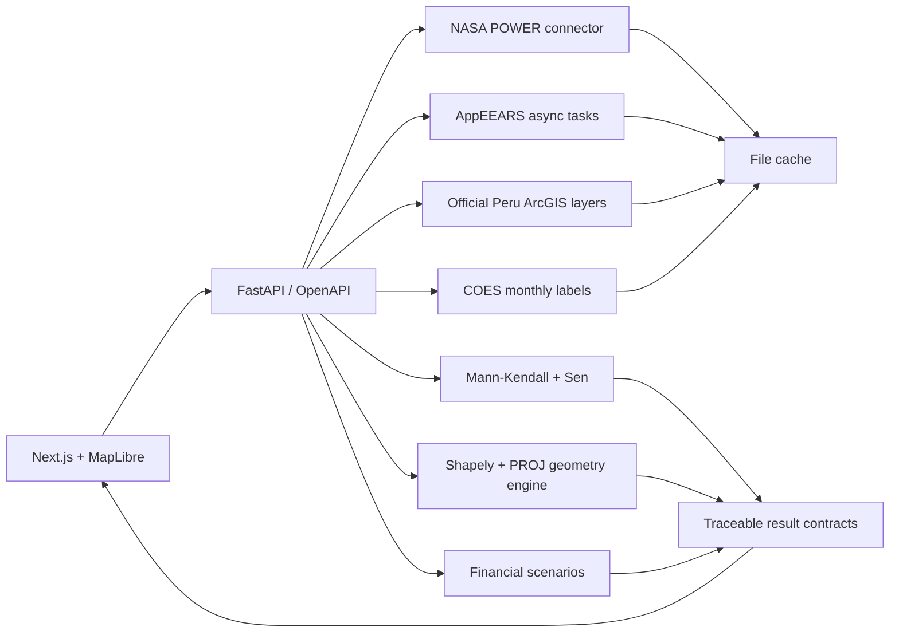

# Technical Architecture

The frontend selects location, variable, and period. The API validates inputs with Pydantic, obtains or reuses NASA data, and emits reproducible contracts. Geometry inspection validates and measures WGS84 features without making unsupported risk claims. The financial engine only accepts explicit user assumptions. Docker Compose runs both layers as an isolated project on ports 3100 and 8000.

Current endpoints:

- `GET /api/v1/health`
- `GET /api/v1/sources`
- `POST /api/v1/analyses/point`
- `POST /api/v1/comparisons/sites`
- `POST /api/v1/geospatial/inspect`
- `POST /api/v1/finance/npv`

- `POST /api/v1/earthdata/appeears/tasks/point`
- `POST /api/v1/earthdata/appeears/tasks/area`
- `GET /api/v1/earthdata/appeears/tasks/{task_id}`
- `GET /api/v1/earthdata/appeears/tasks/{task_id}/bundle`
- `GET /api/v1/earthdata/appeears/tasks/{task_id}/bundle/{file_id}`
- `POST /api/v1/territory/query`
- `POST /api/v1/energy/coes/monthly-generation`

Connector payloads use a content-addressed raw cache: the SHA-256 named provider response is immutable and a small request manifest points to it. AppEEARS credentials and tokens are excluded from both layers. AppEEARS logs in for each operation, renews on HTTP 403, and logs out in `finally`; tasks remain asynchronous at the NASA service. Bundle downloads verify the provider SHA-256 before caching, follow only an explicit HTTPS host allowlist, and never forward the Earthdata token to the object-storage redirect. COES exports are limited to one closed month per provider request and aggregated from 15-minute MW readings to MWh.

PostGIS and a local job queue remain planned for persistent geometries, bulk corridor sampling, and locally managed raster workloads. AppEEARS does not depend on that queue because NASA owns the asynchronous task lifecycle.
